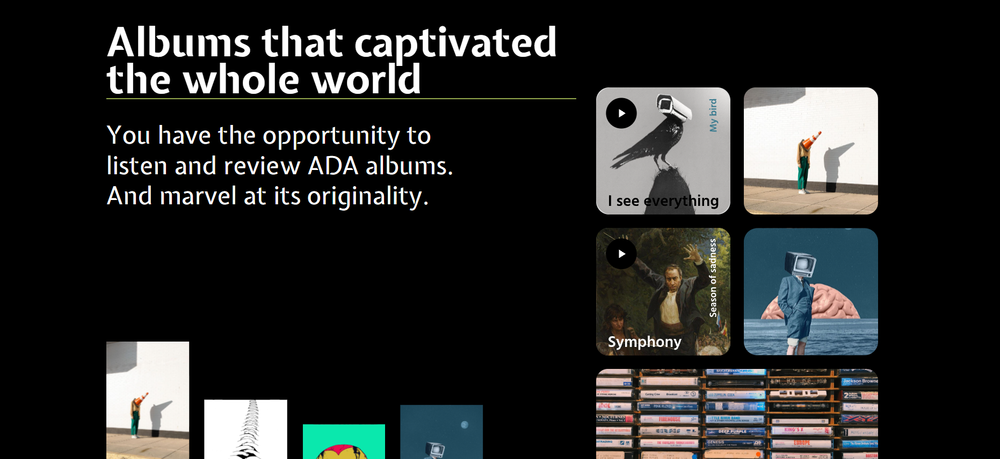

# 🎤 ADA Landing — Artist Concert & Tour Website

**ADA Landing** — самостоятельно разработанный веб-лендинг для музыкального артиста, предназначенный для презентации концертной деятельности, просмотра предстоящих выступлений и оформления заявок на покупку билетов.

Проект был реализован полностью самостоятельно: от создания дизайн-макета в **Figma** до вёрстки и реализации пользовательского интерфейса с помощью **HTML5 и CSS3**.

Основная цель проекта — создать современный и визуально привлекательный сайт, который позволяет поклонникам артиста следить за его концертами и оставлять заявки на приобретение билетов.

---

## 📸 Screenshots

---

## ✨ Features

- 🎤 **Artist Presentation** — презентация артиста и его музыкальной деятельности.
- 🎫 **Concert & Tour Schedule** — просмотр предстоящих концертов и гастрольных туров.
- 📅 **Event Information** — информация о концертных мероприятиях.
- 📝 **Ticket Order Form** — форма для оформления заявки на заказ билетов.
- 🎨 **Custom UI Design** — самостоятельно разработанный дизайн в Figma.
- 📱 **Responsive Layout** — адаптация интерфейса под различные размеры экранов.
- ✨ **Modern Design** — современный визуальный стиль и удобная структура страницы.

---

## 🛠 Tech Stack

| Technology | Purpose |
|---|---|
| Figma | Разработка дизайна и прототипирование |
| HTML5 | Структура веб-страницы |
| CSS3 | Стилизация и оформление интерфейса |
| Flexbox | Построение и выравнивание элементов |

---

## 🏗 Development Process

Проект был реализован самостоятельно и включал несколько этапов:

1. **UI/UX Design** — разработка концепции и создание макета сайта в Figma.
2. **HTML Development** — построение структуры страницы с использованием HTML5.
3. **CSS Styling** — реализация дизайна, оформление блоков, типографики и элементов интерфейса.
4. **Responsive Design** — адаптация лендинга под различные разрешения экранов.
5. **Ticket Order Interface** — создание пользовательского интерфейса формы заказа билетов.

---

## 🧠 What I Learned

В процессе разработки проекта я получил практический опыт:

- Самостоятельного проектирования пользовательских интерфейсов в Figma.
- Создания дизайна с нуля.
- Переноса дизайн-макетов в HTML и CSS.
- Создания лендингов с использованием семантической HTML-разметки.
- Работы с Flexbox и CSS Layout.
- Разработки интерфейсов форм и пользовательских элементов.
- Создания адаптивной вёрстки.
- Организации и структурирования CSS-кода.

---

## 👨‍💻 About the Project

**Developer:** Дастан Алмазбеков

**Role:** UI Designer & Frontend Developer

**Project Name:** ADA Landing

**Project Type:** Artist & Concert Landing Page

**Design Tool:** Figma

**Main Focus:** UI/UX Design, HTML5, CSS3, Responsive Web Design

---

## 🔗 Live Demo

[ADA Landing — Visit Website](<(https://dosymuss.github.io/ada-landing/>)

---

⭐ Thanks for checking out my project!
